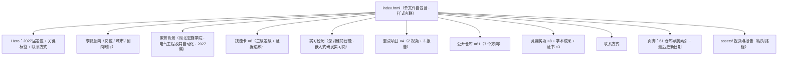

# 尤译庆 · 2027届本科应届生 · 嵌入式软件 / 固件开发

> 我的 GitHub 总入口，也是个人求职主页的源码仓库。站点是一个**单文件、零依赖**的静态页面（样式内联，无 JavaScript、无框架、无构建、无 CDN），
> 面向 **2027届校园招聘（正式全职）** 展示教育背景、求职意向、专业技能、实习经历、重点项目、竞赛奖项，以及 **61 个公开仓库**的完整分类导航。

| 项目速览 | 内容 |
|---|---|
| 站点定位 | 2027届本科应届生求职主页 · 嵌入式软件 / 固件开发方向 |
| 核心平台 | GitHub Pages（静态站，无 JS / 无框架 / 无构建 / 无外部依赖） |
| 部署 | main 分支直发，`.nojekyll` 关闭 Jekyll，HTTPS 已上线 |
| 我的职责 | 站点独立设计与实现、内容组织（教育 / 技能 / 实习 / 项目 / 奖项 / 证书） |
| 项目状态 | 已上线：`https://meminehobe24435-cmyk.github.io/`（HTTP 200） |

---

## 1. 站点简介

嵌入式项目的实物很难在简历上被看到。这个站点把重点项目的**演示视频与完整报告**放到一个链接里，让 HR / 面试官点开就能"看"到项目，而不是只读文字；
同时，它把我 **61 个公开代码仓库**按方向做成完整导航，让技术能力可以顺着链接逐层验证。

站点面向的读者是校园招聘的 HR 与面试官，因此页面的第一屏即明确身份与求职意向：**2027届本科应届生、正式全职、非实习岗位**。

## 2. 内容规模（实测）

| 内容 | 数量 | 说明 |
|---|---|---|
| 重点项目 | **4** | 双目视觉处理系统、CH585 三模无线鼠标、简易自行瞄准装置、运动目标控制与自动追踪系统 |
| 演示视频 | **2** | MP4，合计约 38.5 MB |
| PDF 报告 | **3** | 合计约 13.0 MB（媒体总计约 51.5 MB） |
| 技能卡 | **6** | 程序开发 / 协议调试 / 电路设计 / 硬件调试 / 算法应用 / FPGA 开发，按证据三级定级 |
| 公开仓库 | **61** | 按 7 个方向分类展示，页脚另附完整导航索引 |
| 竞赛奖项 | **8** | 含 1 项国家级竞赛一等奖 |
| 证书 | **3** | CET-4、高压电工证、C1 驾驶证 |
| 学术成果 | **1** | 以第一作者发表论文 1 篇 |

> 说明：4 个重点项目以竞赛报告与演示视频为主要证据，**没有公开代码仓库**（其中 2 项为团队作品）。
> 61 个公开仓库是另一部分可验证的代码证据，两者在页面上分区展示，不混为一谈。

## 3. 我的核心仓库（可公开验证）

| 仓库 | 一句话定位 | 主要技术 | 入口 |
|---|---|---|---|
| 🚀 **esp-recorder** | ESP32-S3 双路串口数据记录仪：双 UART 采集 → SD / FATFS 落盘，USB CDC/MSC 取数 + WiFi Web 配置（实习期间独立交付） | ESP32-S3 / ESP-IDF / FreeRTOS | [仓库](https://github.com/meminehobe24435-cmyk/esp-recorder) |
| ⚙️ **uav-car-adhesion-platform** | STM32 四舵轮小车控制固件（PS2 遥控、CAN、四轮转向、蟹行、失联保护）与 PX4 覆盖层 | STM32F103 / 裸机 / CAN | [仓库](https://github.com/meminehobe24435-cmyk/uav-car-adhesion-platform) |
| 🔧 **ac632n-dev-tools** | 杰理 AC632N 开发工具集：构建 / 烧录 / UART 日志 / 调试界面 / 低功耗 | AC632N / C / Python | [仓库](https://github.com/meminehobe24435-cmyk/ac632n-dev-tools) |
| 🚗 **automotive-can-uds-lab** | CAN 通信、ISO-TP 传输与 UDS 诊断协议实践（含虚拟总线与 SocketCAN / vcan 路径） | Python / CAN / ISO-TP / UDS | [仓库](https://github.com/meminehobe24435-cmyk/automotive-can-uds-lab) |
| 🌿 **second-gen-tea-picking-robot** | 采茶机器人嵌入式控制：级联 PID、力反馈、FreeRTOS 与多总线控制 | STM32 / FreeRTOS / 级联 PID | [仓库](https://github.com/meminehobe24435-cmyk/second-gen-tea-picking-robot) |
| 🖥️ **本仓库** | 求职主页本身（你现在看的这份 README 所属），零依赖单文件静态站 | HTML / CSS / GitHub Pages | [仓库](https://github.com/meminehobe24435-cmyk/meminehobe24435-cmyk.github.io) |

> 上述 5 个代码仓库均可在 GitHub 公开访问；完整清单与一键直达见站点「项目仓库总览」与页脚导航。
> `automotive-can-uds-lab` 为协议层与虚拟总线实践，**不代表量产车验证**；`second-gen-tea-picking-robot` 公开软件版为**仿真验证**，不含实物样机数据。

## 4. 61 个公开仓库 · 7 个方向

| # | 方向 | 数量 | 站点锚点 |
|---|---|---:|---|
| ① | 嵌入式与设备通信 | 14 | [`#cat-embedded`](https://meminehobe24435-cmyk.github.io/#cat-embedded) |
| ② | 机器人与运动控制 | 5 | [`#cat-robot`](https://meminehobe24435-cmyk.github.io/#cat-robot) |
| ③ | 电源与电机控制 | 6 | [`#cat-power`](https://meminehobe24435-cmyk.github.io/#cat-power) |
| ④ | 视觉与 RTL | 9 | [`#cat-vision`](https://meminehobe24435-cmyk.github.io/#cat-vision) |
| ⑤ | AI 与数据分析 | 8 | [`#cat-ai`](https://meminehobe24435-cmyk.github.io/#cat-ai) |
| ⑥ | 后台、测试与工程工具 | 13 | [`#cat-tools`](https://meminehobe24435-cmyk.github.io/#cat-tools) |
| ⑦ | 客户端与网页 | 6 | [`#cat-client`](https://meminehobe24435-cmyk.github.io/#cat-client) |
| | **合计** | **61** | [GitHub 仓库列表](https://github.com/meminehobe24435-cmyk?tab=repositories) |

站点为每个仓库给出「仓库名 + 一句话定位 + GitHub 链接」，并在页脚提供全部 61 条的导航索引。

## 5. 真实性口径（本页与站点一致）

站点面向招聘场景，因此**宁可少写，不写无证据的内容**。具体口径如下：

1. **技能三级定级**：`熟练使用`（有完整源码与实机产物，可独立讲解实现细节）→ `掌握`（在项目 / 实验中实际做过，可回答具体问题，按证据不作最高级表述）→ `了解 / 接触过`（有课程、实验或工具链接触经验，深度有限）。每类技能卡都附一句证据边界说明。
2. **团队边界**：团队作品逐条标注个人分工，例如「双目视觉处理系统」标为**团队作品**，分工为「图像流水线与 FPGA 侧集成」；「运动目标控制与自动追踪系统」标为**团队项目**，仅写参与控制流程实现与系统联调。均不表述为独立完成。
3. **奖项表述**：成绩最高的奖项写为**「国家级竞赛一等奖」**，并明确是**国家级竞赛奖项，非奖学金类荣誉**，避免被误读为奖学金类荣誉。
4. **不展示无原始记录支撑的量化指标**：页面不出现具体轮询率、延迟、续航、良率与效率类比例数字等未经原始记录确认的数值；需要时以原始材料为准。
5. **项目边界随仓库一并标注**：涉及数值仿真、主机端模拟、个人实训的仓库，其定位文字中直接写明边界（如「数值仿真」「主机端实践」「不含真实功率级与量产验证」等），不把实验性内容表述为量产交付。
6. **不列无法验证的私有仓库**：页面只导航公开可访问的仓库，不包含私有仓库链接。

## 6. 站点技术栈

| 类型 | 技术 | 说明 |
|---|---|---|
| 结构 | HTML5 语义化标签 | header / nav / section / article / dl，利于可访问性与 SEO |
| 样式 | **内联 `<style>`** + CSS 变量 + Grid | 单文件自包含，零外部请求；无 CSS 框架 |
| 响应式 | `@media` 900px / 700px 两断点 | 多栏卡片在窄屏塌缩为单栏 |
| 打印 | `@media print` | 隐藏视频与导航、卡片防跨页、关键链接打印展开完整 URL、页脚索引改三栏 |
| 媒体 | MP4 + PDF | 视频 `preload="metadata"`、`playsinline` 控制首屏带宽 |
| 安全 | `target="_blank" rel="noopener noreferrer"` | 防 reverse tabnabbing |
| 部署 | GitHub Pages + `.nojekyll` | 二进制媒体原样输出，不被 Jekyll 处理 |

## 7. 站点架构



## 8. 资源加载（首屏带宽策略）

```
浏览器请求 index.html → 解析（样式内联，无额外 CSS 请求）
→ 视频按 preload="metadata" 只取元数据 → 用户点击播放才拉视频数据
→ PDF 点击后新标签页打开
```

- 页面**不发起任何第三方请求**：无 CDN、无字体、无统计脚本；
- 首屏只加载 HTML 与视频元数据，把约 51.5 MB 媒体的成本推迟到用户主动触发；
- `.nojekyll` 保证 MP4 / PDF 不被 Jekyll 改写路径。

## 9. ⭐ 核心代码导览

| 文件 | 作用 | 推荐程度 |
| --- | --- | --- |
| [index.html](index.html) | **单文件求职主页**：结构、内联样式、响应式与打印样式、全部内容 | ⭐⭐⭐⭐⭐ |
| [assets/videos/binocular-vision.mp4](assets/videos/binocular-vision.mp4) | 双目视觉处理系统演示视频 | ⭐⭐⭐⭐ |
| [assets/reports/binocular-vision-report.pdf](assets/reports/binocular-vision-report.pdf) | 代表报告（66 页） | ⭐⭐⭐⭐ |
| [docs/interview/](docs/interview/) | 深度技术文档 15 篇（项目总览、技术栈、代码走查、面试问答等） | ⭐⭐⭐⭐ |
| [styles.css](styles.css) | 旧版外部样式表：**已不再被 index.html 引用**（改版后样式已内联），作为历史文件保留 | ⭐ |

## 10. 技术难点与取舍

- **单文件自包含 vs 外部样式表**：改版后选择**样式内联**，换取"零额外请求、可离线打开、打印样式可控、单文件可直接分发"；代价是 index.html 变长约 56 KB。原 `styles.css` 保留在仓库中未删除，但已不被页面引用。
- **大媒体与首屏的矛盾**：`preload="metadata"` + 点击加载解决；进一步可加 poster 封面与懒加载。
- **页面要同时服务两类读者**：HR 需要一屏内的定位与关键信息，面试官需要可验证的技术入口。因此首屏只放身份 / 意向 / 联系方式，技术细节（61 个仓库）沉到后半部分并配页脚索引。
- **打印场景**：HR 常把主页打印成附件，因此补了 `@media print`：隐藏视频与导航、卡片避免跨页断裂、关键外链自动展开完整 URL。
- **诚实性与可读性的平衡**：把"边界说明"直接写在技能卡与项目卡里，而不是靠小字免责声明，避免读者按最高档位想象。

## 11. 工程优化

**已实现**：语义化标签、aria-label、viewport、meta description、内联样式零外部依赖、`preload="metadata"`、`rel="noopener noreferrer"`、`.nojekyll`、响应式两断点、`@media print` 打印样式。

**如果重做**：视频加 poster 封面并统一 H.264 编码；补 favicon 与 OG / Twitter 卡片元数据；对 61 个仓库卡片做按语言或关键词过滤；考虑引入极简静态生成以降低单文件维护成本。

## 12. 👨‍💻 我的主要工作

- 站点独立设计与实现（内容结构、内联样式、响应式与打印适配、单文件重构）；
- 4 个重点项目的视频 / 报告整理与挂载（相对路径与线上可达性逐条验证）；
- 61 个公开仓库的清点、按 7 个方向重新分类、逐条撰写一句话定位并核对链接；
- 真实性口径的落地：技能三级定级、团队分工标注、奖项表述校准、量化指标筛查；
- 教育背景、求职意向、实习经历、奖项、证书、联系方式的组织。

## 13. 🎯 项目能力映射

| 能力 | 体现 |
|---|---|
| 前端基础 | 语义化 HTML、CSS Grid 与变量、响应式断点、打印样式表 |
| 资源与性能 | 首屏带宽策略、零第三方请求、媒体延迟加载 |
| 内容工程 | 把技术项目翻译成招聘场景可快速判断的信息结构 |
| 信息治理 | 61 个仓库的清点、分类、逐条定位与链接可用性校验 |
| 版本管理 | Git + GitHub Pages 发布流程（main 分支直发） |

## 14. 🗣️ 项目设计总结

**项目摘要**：我做了一个零依赖的单文件 GitHub Pages 求职主页，把 4 个重点项目的演示视频与完整报告放在一个链接里，让招聘方直接"看"到项目；同时把它做成我 **61 个公开仓库**的完整分类导航，让技术能力可以顺着链接逐层验证。

**核心设计说明**：语义化 HTML、内联样式实现零外部依赖、CSS Grid 响应式两断点、`@media print` 打印适配、视频 `preload="metadata"` 控制首屏带宽、`rel="noopener noreferrer"` 防 tab 劫持、`.nojekyll` 保证二进制媒体正常发布。

**完整技术说明**：讲"为什么做"（嵌入式实物不可见 → 作品可视化，且必须直接对上"2027届正式校招"的定位）→ 内容结构（意向 / 教育 / 技能 / 实习 / 项目 / 仓库 / 奖项 / 联系）→ 技术取舍（单文件自包含、带宽策略、可访问性、打印友好）→ 诚实口径（技能按证据分级、团队项目标明分工、无原始记录的指标不写）。

## 15. 设计思考与 FAQ

1. **Q：为什么用静态站不用框架？** A：单页展示、内容为主，框架是负资产；零依赖也意味着零构建、零维护、零第三方请求。
2. **Q：为什么样式从外部 CSS 改成内联？** A：换取零额外请求、可离线打开与更可控的打印效果；代价是单文件变长，已在"技术难点与取舍"中说明。
3. **Q：站点上的 4 个重点项目和 61 个仓库是什么关系？** A：两组证据分区展示。4 个重点项目以竞赛报告与演示视频为证据、没有公开代码仓库（其中 2 项为团队作品）；其余 61 个公开仓库全部按方向列出并附 GitHub 链接，页脚提供完整索引，两者不混淆。
4. **Q：技能定级为什么不用更高档的表述？** A：站点按项目证据分级——能做能讲的写"熟练使用"，项目里做过但不便展开的写"掌握"，只有课程或工具链接触的写"了解 / 接触过"。招聘场景下，可验证比听起来强更有价值。
5. **Q：团队项目怎么处理署名？** A：逐条标注个人分工（如"团队作品 · 负责图像流水线与 FPGA 侧集成"），不表述为独立完成。
6. **Q：SEO / 无障碍做了什么？** A：语义化标签、aria-label、meta description、`lang="zh-CN"`；OG / 结构化数据是改进项。

## 16. 📎 深入阅读

- [00 项目总览](docs/interview/00_PROJECT_OVERVIEW.md)
- [03 代码讲解](docs/interview/03_CODE_WALKTHROUGH.md)
- [10 技术文档](docs/interview/10_INTERVIEW_QA.md)
- [线上站点](https://meminehobe24435-cmyk.github.io/)

---

## 开发者使用信息

- 本地预览：直接打开 `index.html`，或 `python -m http.server`；
- 发布：push 到 main，GitHub Pages 自动发布；站点根目录 `.nojekyll` 必须保留；
- 修改：**编辑 `index.html` 即可**（样式已内联在文件内的 `<style>` 中）；新增媒体放 `assets/videos/` 或 `assets/reports/`，并在 `index.html` 中用相对路径引用；
- `styles.css` 为历史文件，当前不被 `index.html` 引用，保留未删除；
- 修改后建议核查：媒体相对路径可达、禁用的未经证实指标未混入、团队项目分工标注未丢失。
